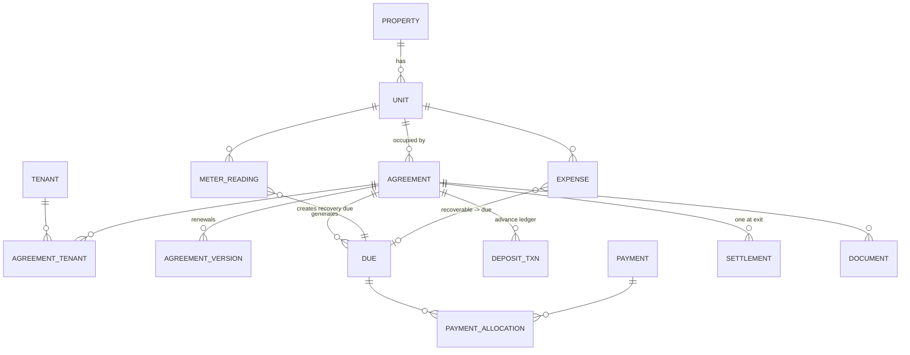

# Rental Suite — Product Requirements Document (PRD)

| | |
|---|---|
| **Product** | Rental Suite — Rent & Lease Management for a Private Landlord |
| **Version** | 1.0 (Approved) |
| **Date** | 2026-11-12 |
| **Status** | Approved — ready for build |
| **Platform** | Responsive web app (browser; phone + desktop) |
| **Users** | Single owner (house owner) only; no tenant logins in v1 |
| **Currency / Locale** | INR (₹), Indian digit grouping (1,23,456), IST dates, English UI |
| **Confirmed stack** | Next.js (App Router) + TypeScript + Tailwind, deployed on Cloudflare Workers with a D1 (SQLite) database |

---

## 1. Overview

The owner owns several properties — houses, shops, and individual rooms — given out on monthly rent or lease to tenants. Today this is managed on paper/spreadsheets. **Rental Suite** digitizes the full rental lifecycle in one place:

> Property & units → Tenants → Agreements (rent/lease) → Monthly rent dues → Payments & receipts → Electricity/water bill recovery → Miscellaneous expenses → Advance (deposit) settlement & refund at exit → Reports.

The system's job: **never lose track of money owed to the owner, money owed by the owner (refunds), or documents.**

### 1.1 Goals
1. Single source of truth for all properties, tenants, agreements, and money.
2. Automatic monthly rent dues with arrears and partial-payment tracking.
3. Clear deposit ledger: how much advance is held per tenant and the exact refund computation at exit.
4. Utility (electricity/water) charges generated from meter readings and recovered from tenants.
5. Printable receipts and tenant statements; owner-level Excel/CSV exports.
6. Usable on a phone browser while standing at a property collecting rent.

### 1.2 Non-goals (v1)
- No tenant portal / tenant logins.
- No online payment gateway integration (record payments manually; UPI reference stored).
- No GST/tax filing engine (exports support the owner's accountant instead).
- No automatic SMS/WhatsApp sending in v1 (planned for M4).
- No multi-owner / staff roles (single owner account).

---

## 2. Users & Personas

**Primary persona — The Owner (single user)**
- Non-technical landlord managing 5–50 units across several properties.
- Logs in occasionally, but intensively at month start (collect rent, take readings) and at move-in/move-out.
- Needs: dues at a glance, quick payment entry, printable receipt on the spot (phone), arrears follow-up list, lease expiry warnings, deposit refund calculation at exit.

**Secondary persona — The Owner's Accountant (indirect)**
- Receives Excel/CSV exports and printed statements; does not log in.

---

## 3. Glossary

| Term | Meaning |
|---|---|
| Property | A physical address owned by the owner (house, shop building) |
| Unit | One rentable space within a property: a house unit, a shop, a room |
| Agreement | Contract with tenant(s): monthly **rent** or long-term **lease** |
| Advance / Deposit | Refundable money taken from tenant at start (Indian "advance") |
| Due (Charge) | Amount owed by tenant for a period: rent, electricity, water, late fee, misc recovery |
| Arrears | Accumulated unpaid dues (balance) of a tenant |
| Proration | Rent for a partial month (mid-month move-in/exit) |
| Settlement | End-of-tenancy calculation: refundable advance minus outstanding dues minus deductions |
| Recovery | Owner-paid utility/expense charged back to the tenant |

---

## 4. Functional Requirements

> Priority: **P0** = MVP-critical, **P1** = v1, **P2** = later phase.

### FR-100 — Settings & Owner Profile (P0)
- Owner profile: name, phone, email, address, PAN (optional) — used on receipts/statements.
- Configurable: default rent due day, receipt number prefix, payment modes (Cash, UPI, Bank Transfer, Cheque, Other), expense categories (Repair, Plumbing, Painting, Property Tax, Association Fees, Cleaning, Other), default electricity tariff (₹/unit) and fixed charge, water mode (metered / flat rate) and flat rate, late fee rule (off by default; flat or per-day if enabled).
- Acceptance: settings changes take effect for newly generated dues/receipts; existing records unaffected.

### FR-200 — Properties & Units (P0)
- Property: name, type (House / Shop / Building / Other), address, notes. Photo optional (P2).
- Unit belongs to a property: label (e.g., "House A – 1st Floor", "Shop 2", "Room 3"), type (House / Shop / Room / Other), area (sq.ft, optional), expected rent, status (Vacant / Occupied / Under maintenance), electricity meter no., water meter no., notes.
- Unit status: **Occupied is derived** from an active agreement; manual statuses only Vacant/Maintenance when no active agreement.
- Cannot delete a unit with any agreement history (deactivate instead).
- Acceptance: creating a property with N units shows all units grouped by property; occupied units reflect active agreements immediately.

### FR-300 — Tenants (P0)
- Fields: full name, phone (required), alternate phone, email, permanent address, ID type (Aadhaar / PAN / Driving Licence / Voter ID / Passport / Other), ID number, ID document attachment (photo/PDF), occupation, family/emergency contact, notes.
- Tenant profile shows: current agreement(s), complete history of past agreements, total collected to date, current balance (arrears).
- Acceptance: tenant search by name/phone; history lists every unit and period the tenant occupied.

### FR-400 — Agreements (Rent & Lease) (P0)
- Auto agreement number (e.g., AGR-2026-001).
- Fields: type (**Rent** monthly / **Lease**), unit, tenant(s) (one or more), start date, end date, monthly rent, rent due day, **advance amount** with receipt details (date, mode, reference), escalation rule (optional: % and frequency, e.g., 5% yearly), notice period (days), agreement document attachment (scan/photo/PDF), terms/notes.
- Validation: unit must be vacant (or end date after current active agreement ends, to create an "upcoming" agreement); end date > start date; advance ≥ 0.
- Statuses: Upcoming → Active → Expired / Terminated. Expired agreements can be **renewed** in one action: extend dates, revise rent (and record any additional advance taken).
- Mid-month move-in: first due is **prorated** (rent × days occupied ÷ days in month) unless owner chooses full month.
- Terminating early: records termination date, reason; triggers exit workflow (FR-700).
- Acceptance: creating an agreement marks the unit Occupied; renewal creates a new linked agreement version, preserving history.

### FR-500 — Rent Dues & Invoices (P0)
- For every active agreement, a **monthly rent due** is generated on the rent due day (auto-generation job, plus lazy generation on app open for missed periods).
- Due fields: type (Rent / Electricity / Water / Late fee / Misc recovery / Damage), agreement, period (month), amount, due date, status (**Pending / Partial / Paid / Overdue / Waived**), balance, notes.
- Overdue is auto-set when due date passes with balance > 0.
- Waive action with reason (audit-logged).
- Acceptance: dues appear automatically each month; a mid-month exit produces one prorated final rent due.

### FR-600 — Payments & Receipts (P0)
- Record payment: date, amount, mode, reference (UPI txn ID / cheque no), remarks; allocate amount across one or more open dues (FIFO default, manual override allowed).
- Partial payments allowed; balance carried forward.
- Auto-generated sequential **receipt number**; printable/PDF receipt showing owner details, tenant, unit, period(s) paid, mode, reference, amount in figures and words (₹).
- Editing/deleting a payment is audit-logged and reverses its allocations.
- Acceptance: paying two months at once produces one receipt covering both periods; a ₹5,000 part-payment on a ₹10,000 due shows balance ₹5,000.

### FR-700 — Advance (Deposit) Ledger & Exit Settlement (P0)
- Deposit ledger per agreement: initial advance received, additional top-ups (renewal), any refunds made.
- **Settlement wizard** at move-out:
  1. Final meter readings (electricity/water) → generate final utility dues.
  2. Final prorated rent due up to exit date.
  3. Any other outstanding dues listed (arrears).
  4. Deductions entered by owner (damages/repairs, unpaid dues) with amounts and reasons.
  5. Computation: **Refundable = Total advance − Outstanding dues − Deductions**; negative net means tenant owes owner.
  6. Record refund: date, mode, reference, acknowledgment note/photo; agreement closed; unit becomes Vacant.
- Acceptance: an exit with ₹50,000 advance, ₹4,000 outstanding rent, ₹1,000 damage shows refund ₹45,000; refund record is immutable after save (corrections via audit-logged reversal).

### FR-800 — Electricity & Water (P1)
- **Meter readings** per unit per service: reading date, previous reading (auto from last), current reading, units consumed (validated current ≥ previous), tariff rate (default from settings, editable per reading), fixed charges, bill amount = units × rate + fixed.
- **Water**: metered (same as above) or flat monthly rate per unit.
- Bill handling: (a) tenant pays utility directly — no due created, record for reference; (b) owner pays and recovers — a due of type Electricity/Water is created for the tenant, with the owner's payment logged as a recoverable expense automatically.
- Acceptance: reading entry of prev 1000 → curr 1050 at ₹8/unit + ₹90 fixed creates a ₹490 tenant due; water flat rate creates the same due monthly without readings.

### FR-900 — Miscellaneous Expenses (P1)
- Fields: date, category (from settings), property and/or unit (optional — "general" allowed), amount, mode, paid by, voucher/bill attachment, notes.
- Flag: **Owner-borne** or **Tenant-recoverable**; recoverable expenses on an occupied unit create a Misc recovery due on that agreement.
- Acceptance: ₹2,500 plumbing marked recoverable appears in tenant's dues and in the property's expense report.

### FR-1000 — Dashboard (P0)
- Cards: total units, occupied, vacant, rent due this month, collected this month, overdue total, total advances held (liability).
- Lists: upcoming lease expiries (next 30/60/90 days toggle), top arrears tenants, recent payments.
- Charts: collections last 6/12 months; income vs expense last 12 months.
- Acceptance: dashboard loads < 2s with representative data; every card deep-links to its filtered list.

### FR-1100 — Reports & Exports (P1)
All reports: date-range / month / property filters; print view; **Excel (xlsx) and CSV export**.
- R1 Monthly collection register (per agreement: due, collected, balance, status)
- R2 Outstanding arrears per tenant (with aging buckets)
- R3 Income vs expense, overall and per property
- R4 Deposit ledger (advances currently held)
- R5 Utility recovery status (generated vs recovered)
- R6 Vacancy report (unit, vacant since, lost-rent estimate)
- R7 Lease expiry report (30/60/90 days)
- R8 Tenant statement (printable PDF: all dues, payments, balance for a tenancy)
- R9 Expense register (by category/property)
- Acceptance: every report opens with default "this month" filter and exports a valid xlsx.

### FR-1200 — Documents & Attachments (P1)
- Attach images/PDFs to: tenant ID proofs, agreements, payment receipts, expense vouchers, refund acknowledgments.
- Stored on local disk/server volume with paths in DB; download/preview from record pages.

### FR-1300 — Audit, Security & Housekeeping (P0)
- Single-owner login (email + password, bcrypt, session cookie). HTTPS when hosted.
- Audit log for create/update/delete on agreements, dues, payments, deposits, refunds (old → new values).
- Manual backup: one-click download of full database + exports; documented daily auto-backup script (P1).
- Soft-delete everywhere (nothing hard-deleted if money-related).

---

## 5. Data Model



**Entities & key fields**

| Entity | Key fields |
|---|---|
| Property | id, name, type, address, notes |
| Unit | id, propertyId, label, type, areaSqft, expectedRent, status, elecMeterNo, waterMeterNo, notes |
| Tenant | id, name, phone, altPhone, email, address, idType, idNumber, idDocPath, occupation, notes |
| Agreement | id, number, type (rent/lease), unitId, startDate, endDate, rent, dueDay, advance, noticeDays, escalationPct, status, docPath, terms, supersededById |
| AgreementTenant | agreementId, tenantId, isPrimary |
| Due | id, agreementId, type, period, amount, dueDate, status, balance, waivedReason, sourceRef |
| Payment | id, agreementId, date, amount, mode, reference, receiptNo, remarks |
| PaymentAllocation | paymentId, dueId, amount |
| DepositTxn | id, agreementId, type (received/topup/refund/deduction), amount, date, mode, reference, reason, docPath |
| Settlement | id, agreementId, exitDate, finalReadingsRef, totalAdvance, totalOutstanding, deductions, refundable, refundDate, refundMode, acknowledgment |
| MeterReading | id, unitId, service (elec/water), readingDate, prevReading, currReading, units, rate, fixedCharge, billAmount, billedTo (tenant/owner) |
| Expense | id, date, categoryId, propertyId, unitId, amount, mode, voucherPath, recoverable, agreementId, notes |
| Document | id, ownerEntity, entityId, label, path, mime |
| AuditLog | id, entity, entityId, action, beforeJson, afterJson, at |
| Settings | singleton: owner profile, defaults, categories, modes, prefixes |

---

## 6. Key Workflows

**W1 Onboard tenant (move-in):** Add/choose tenant → Create agreement (dates, rent, advance) → Save → advance recorded in deposit ledger → first prorated due generated → unit shows Occupied.

**W2 Monthly cycle (owner's routine):** Open dashboard → see due list → take meter readings per unit → utility dues generated → mark payments as collected (mode + reference) → print/receipt on phone → overdue list shrinks as payments recorded.

**W3 Renewal:** On expiry warning → Renew → new end date, revised rent, optional additional advance → linked version created, history preserved.

**W4 Exit (move-out):** Terminate/reach end date → Settlement wizard: final readings → final rent → outstanding list → deductions → refund computed → record refund → agreement Terminated/Expired → unit Vacant → tenant profile shows closed history.

**W5 Expense recovery:** Log expense → mark recoverable → due appears in tenant's monthly list → collected with rent.

---

## 7. Non-Functional Requirements

1. **Responsive UI:** fully usable on a 360px-wide phone browser; large touch targets for payment entry.
2. **INR formatting:** Indian digit grouping everywhere (₹1,23,456); amounts in words on receipts; IST timezone.
3. **Performance:** < 2s page loads; comfortable with 100+ units and 10 years of records (indexed queries).
4. **Reliability:** SQLite file DB; daily auto-backup script; export/backup anytime.
5. **Security:** owner-only auth, bcrypt passwords, session cookies, HTTPS in hosted mode, no money record hard-deletes, full audit trail.
6. **Simplicity:** zero external services required at runtime; can run fully offline on the owner's PC (localhost) or on a cheap VPS.

---

## 8. Tech Stack & Architecture

| Layer | Choice |
|---|---|
| Framework | **Next.js (App Router) + TypeScript** |
| UI | Tailwind CSS + shadcn/ui, recharts for charts |
| DB | **SQLite** via Prisma (single-file, zero-admin) |
| Auth | Credentials login (email+password), session cookie |
| Forms/validation | react-hook-form + zod |
| Dates/money | date-fns, custom INR formatter (Indian grouping) |
| Exports | SheetJS (xlsx) for Excel/CSV; print-CSS for receipts & statements |
| Background | Monthly due generation via cron-style job on server + lazy catch-up on app open |
| Deploy | Local (`npm run build && npm start`) or small VPS/PaaS; volume for SQLite file + uploads |

**Project layout (planned)**
```
rental-suite/
  prisma/schema.prisma
  src/app/(auth)/login
  src/app/(dashboard)/dashboard | properties | tenants | agreements | dues | payments | utilities | expenses | deposits | reports | settings
  src/lib/db.ts | money.ts | dues.ts | settlement.ts
  src/server/actions/*.ts   (server actions per module)
```

---

## 9. Roadmap

| Milestone | Scope | Exit criteria |
|---|---|---|
| **M1 — MVP core** | Properties/units, tenants, agreements, auto rent dues, payments + allocations, receipts, login, dashboard, audit log | Owner can onboard a tenant, collect 2 months' rent, and see correct arrears |
| **M2 — Utilities & expenses** | Meter readings, electricity/water dues, misc expenses & recoveries, expense register | A month's cycle including readings and a recoverable repair runs end-to-end |
| **M3 — Settlement & reports** | Deposit ledger, exit settlement wizard, all reports R1–R9, xlsx export, tenant statement PDF | A tenant exits with correct refund; accountant receives exports |
| **M4 — Polish** | Reminders (email/WhatsApp via manual links), auto-backup, documents area, UI polish, seed/demo data | Daily-use friction removed; backups verified |

---

## 10. Open Questions (to resolve during build)

1. Late fee: needed at all? Default off in settings (decided: off by default).
2. Should utilities support shared meters (bill split across units)? → assumed **no** in v1 (each unit has own meter); revisit if owner has shared meters.
3. Import existing data from the owner's current spreadsheet? → plan an Excel import template in M4.
4. Second trusted user (e.g., spouse/manager) login? → out of scope v1.

## 11. Success Criteria

- Owner replaces the spreadsheet entirely within one month of use.
- Zero rent dues forgotten: dashboard + arrears report reconcile with actual collections.
- Every deposit refund is computed and documented from the ledger, with no disputes.
- Receipt issued within 30 seconds at the doorstep on a phone.
