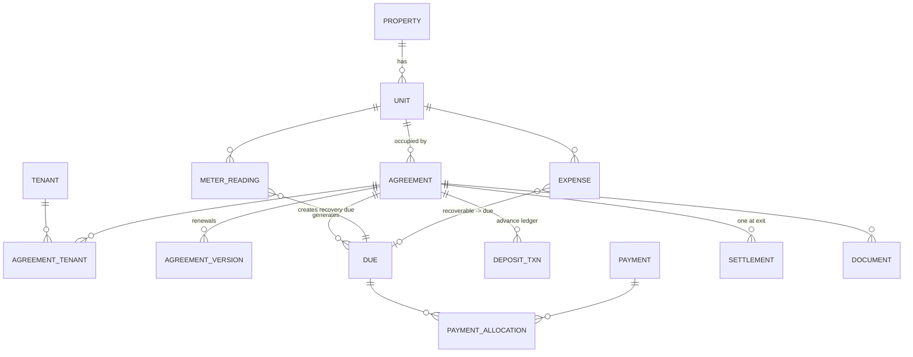

# Rental Suite — Complete Project Context & Handoff Document

> Purpose: a single self-contained document describing the entire product discussion, decisions, requirements, architecture, and current build state of the **Rental Suite** application. Intended so that any developer (human or AI) can continue the project with full context.

| | |
|---|---|
| **Project** | Rental Suite — Rent & Lease Management for a Private Landlord |
| **Project folder** | `D:\Rental suite` (Windows 11, not a git repo yet) |
| **Date** | 2026-11-15 |
| **Status** | M1 build in progress (scaffold + schema + core libs done; UI screens next) |
| **Owner persona** | Single non-technical house owner in India; owns houses, shops, and rooms rented/leased to tenants |

---

## 1. Original Requirement (user's words, summarized)

Build a rental suite where a house owner can manage rents and leases. The owner owns **several houses, shops, and rooms** given on rent or lease to tenants. The application must handle:

- Rents (monthly collection, arrears)
- **Advance amount** (Indian-style refundable deposit) and **return amount** (settlement/refund at exit)
- Tenant details (profiles, ID/KYC)
- Agreements (rent agreements and leases, start/end dates, renewals)
- **Electricity bill** and **water bill** (meter readings, charges, recovery from tenants)
- **Miscellaneous expenses** (repairs, maintenance, etc.)
- "…and whatever requires for the rental management" — dashboards, reports, receipts, reminders

## 2. Decisions Made During Discussion (Q&A)

| Question | Decision | Rationale |
|---|---|---|
| Platform | **Web app in browser** (phone + desktop responsive) | Owner collects rent on-site with a phone; works everywhere |
| Currency / locale | **INR (₹), India** — Indian digit grouping (1,23,456), IST timezone, English UI | Owner's context |
| Who logs in | **Owner-only** (no tenant portal in v1) | Simplest MVP; tenant portal is a future phase |
| App framework | **Next.js (App Router) + TypeScript + Tailwind CSS** | User accepted recommendation |
| Database model | **Embedded SQLite-style DB** (no separate DB server like MongoDB/Postgres) | User explicitly confirmed: "we are not storing data in any separate database like mongo db, we are storing it in backend directly" |
| Hosting | **Cloudflare Pages/Workers + Cloudflare D1** (free tier) | See §4 for the full decision journey |
| UI approach | **shadcn/ui + Tailwind**, using *shadcn-admin* (github.com/satnaing/shadcn-admin) as visual reference; **Recharts** for charts | Avoids client-heavy admin templates that fight Next.js server components; free; modern |

Key conversation clarifications preserved:

- User asked "what is Prisma?" → explained ORMs. Later the ORM choice shifted to **Drizzle** (Cloudflare's officially supported ORM for D1). Same role as Prisma ("the librarian" between code and database).
- User asked about hosting options → explored Render, Railway, Fly.io, Oracle Cloud Always Free, Turso, Vercel+Turso, Cloudflare D1, Supabase. Final: **Cloudflare Workers + D1** (free, no cold starts, no pausing, SQLite-compatible).
- User asked "why not Supabase / can browser talk directly to DB?" → analyzed BaaS/no-backend architecture: possible with Supabase RLS but rejected for **money-integrity reasons** (business logic in browser, race conditions on balances, receipt numbering, audit trail). Kept server-side logic.
- User asked about dashboard UI templates → explained the category names ("admin dashboard template", "admin panel", "UI kit", "CRUD admin framework") and platforms; chose shadcn/ui route.

## 3. Product Requirements Document (PRD v1.0 — full text)

### 3.1 Overview

The owner owns several properties — houses, shops, and individual rooms — given out on monthly rent or lease to tenants. **Rental Suite** digitizes the full rental lifecycle:

> Property & units → Tenants → Agreements (rent/lease) → Monthly rent dues → Payments & receipts → Electricity/water bill recovery → Miscellaneous expenses → Advance (deposit) settlement & refund at exit → Reports.

The system's job: **never lose track of money owed to the owner, money owed by the owner (refunds), or documents.**

**Goals**
1. Single source of truth for all properties, tenants, agreements, and money.
2. Automatic monthly rent dues with arrears and partial-payment tracking.
3. Clear deposit ledger: advance held per tenant and exact refund computation at exit.
4. Utility (electricity/water) charges generated from meter readings and recovered from tenants.
5. Printable receipts and tenant statements; owner-level Excel/CSV exports.
6. Usable on a phone browser while standing at a property collecting rent.

**Non-goals (v1)**: no tenant portal/logins; no payment gateway integration; no GST/tax filing engine; no automatic SMS/WhatsApp in v1; no multi-owner/staff roles.

### 3.2 Users & Personas

- **Primary — The Owner (single user):** non-technical landlord, 5–50 units. Intensive use at month start (collect rent, meter readings) and at move-in/move-out. Needs: dues at a glance, quick payment entry, printable receipt on the spot, arrears follow-up list, lease expiry warnings, deposit refund calculation at exit.
- **Secondary — The Owner's Accountant (indirect):** receives Excel/CSV exports and printed statements; does not log in.

### 3.3 Glossary

| Term | Meaning |
|---|---|
| Property | A physical address owned by the owner (house, shop building) |
| Unit | One rentable space within a property: a house unit, a shop, a room |
| Agreement | Contract with tenant(s): monthly **rent** or long-term **lease** |
| Advance / Deposit | Refundable money taken from tenant at start |
| Due (Charge) | Amount owed by tenant: rent, electricity, water, late fee, misc recovery |
| Arrears | Accumulated unpaid dues (balance) of a tenant |
| Proration | Rent for a partial month (mid-month move-in/exit) |
| Settlement | End-of-tenancy calculation: refundable advance minus outstanding dues minus deductions |
| Recovery | Owner-paid utility/expense charged back to the tenant |

### 3.4 Functional Requirements

> Priority: **P0** = MVP-critical, **P1** = v1, **P2** = later phase.

**FR-100 — Settings & Owner Profile (P0)**
Owner profile (name, phone, email, address, PAN) used on receipts/statements. Configurable: default rent due day, receipt number prefix, payment modes (Cash, UPI, Bank Transfer, Cheque, Other), expense categories (Repair, Plumbing, Painting, Property Tax, Association Fees, Cleaning, Other), default electricity tariff (₹/unit) + fixed charge, water mode (metered / flat rate), late fee rule (off by default). Acceptance: settings changes take effect for newly generated dues/receipts; existing records unaffected.

**FR-200 — Properties & Units (P0)**
Property: name, type (House/Shop/Building/Other), address, notes. Unit: label, type (House/Shop/Room/Other), area sq.ft, expected rent, status (Vacant/Occupied/Under maintenance), electricity meter no., water meter no., notes. **Occupied is derived from active agreements**; only Vacant/Maintenance stored manually. Cannot delete a unit with agreement history (deactivate). Acceptance: units grouped by property; occupancy reflects active agreements immediately.

**FR-300 — Tenants (P0)**
Name, phone (required), alt phone, email, permanent address, ID type (Aadhaar/PAN/DL/Voter/Passport/Other), ID number, ID document attachment, occupation, emergency contact, notes. Tenant profile shows current agreements, complete history, total collected, current balance. Acceptance: search by name/phone; full unit/period history.

**FR-400 — Agreements (Rent & Lease) (P0)**
Auto agreement number (AGR-2026-001). Type (Rent monthly / Lease), unit, tenant(s) (one or more), start/end dates, monthly rent, rent due day, **advance amount** with receipt details (date, mode, reference), escalation rule (% per year, optional), notice period (days), agreement document attachment, terms/notes. Validation: unit vacant (or create "upcoming" if it starts after current ends); end > start; advance ≥ 0. Statuses: Upcoming → Active → Expired/Terminated. **Renewal in one action**: extend dates, revise rent, record additional advance; creates linked agreement version (supersededById). Mid-month move-in: first due **prorated** (rent × days occupied ÷ days in month) unless owner chooses full month. Early termination: records date + reason, triggers exit workflow (FR-700).

**FR-500 — Rent Dues & Invoices (P0)**
Monthly rent due auto-generated per active agreement (job + lazy catch-up on app open). Due fields: type (Rent/Electricity/Water/Late fee/Misc recovery/Damage), agreement, period (month), amount, due date, status (**Pending/Partial/Paid/Overdue/Waived**), balance, notes. Overdue auto-set when due date passes with balance > 0. Waive with reason (audit-logged). Acceptance: dues appear automatically; mid-month exit produces one prorated final rent due.

**FR-600 — Payments & Receipts (P0)**
Payment: date, amount, mode, reference (UPI txn/cheque no), remarks; allocated across one or more open dues (FIFO default, manual override). Partial payments allowed; balance carries forward. Auto sequential **receipt number**; printable/PDF receipt (owner details, tenant, unit, periods paid, mode, reference, amount in figures + words). Editing/deleting a payment is audit-logged and reverses allocations. Acceptance: one payment covering two months → one receipt covering both periods; ₹5,000 part-payment on ₹10,000 due shows balance ₹5,000.

**FR-700 — Advance (Deposit) Ledger & Exit Settlement (P0)**
Deposit ledger per agreement: initial advance, top-ups, refunds. **Settlement wizard** at move-out: (1) final meter readings → final utility dues; (2) final prorated rent; (3) list outstanding arrears; (4) deductions (damages, unpaid dues) with reasons; (5) **Refundable = Total advance − Outstanding dues − Deductions** (negative = tenant owes owner); (6) record refund (date, mode, reference, acknowledgment) → agreement closed → unit Vacant. Acceptance: ₹50,000 advance, ₹4,000 outstanding, ₹1,000 damage → refund ₹45,000; refund record immutable (corrections via audit-logged reversal).

**FR-800 — Electricity & Water (P1)**
Meter readings per unit per service: reading date, previous reading (auto from last), current reading, units consumed (validated current ≥ previous), tariff rate (default from settings, editable), fixed charges, bill = units × rate + fixed. Water: metered or flat monthly rate. Bill handling: (a) tenant pays directly (record only); (b) owner pays and recovers → creates a due for the tenant + recoverable expense automatically. Acceptance: prev 1000 → curr 1050 at ₹8/unit + ₹90 fixed → ₹490 tenant due; flat water rate creates monthly due without readings.

**FR-900 — Miscellaneous Expenses (P1)**
Date, category, property/unit (or "general"), amount, mode, paid by, voucher attachment, notes. Flag **Owner-borne** or **Tenant-recoverable**; recoverable expenses on an occupied unit create a Misc recovery due. Acceptance: ₹2,500 recoverable plumbing appears in tenant dues and property expense report.

**FR-1000 — Dashboard (P0)**
Cards: total units, occupied, vacant, rent due this month, collected this month, overdue total, total advances held (liability). Lists: upcoming lease expiries (30/60/90 toggle), top arrears tenants, recent payments. Charts: collections last 6/12 months; income vs expense. Acceptance: < 2s load; every card deep-links to filtered list.

**FR-1100 — Reports & Exports (P1)**
Filters (date range/month/property), print view, **xlsx + CSV export**. R1 Monthly collection register; R2 Outstanding arrears per tenant (aging); R3 Income vs expense (overall + per property); R4 Deposit ledger; R5 Utility recovery status; R6 Vacancy report (vacant since, lost-rent estimate); R7 Lease expiry (30/60/90 days); R8 Tenant statement (printable PDF); R9 Expense register. Acceptance: default "this month" filter; valid xlsx export.

**FR-1200 — Documents & Attachments (P1)**
Attach images/PDFs to tenant ID proofs, agreements, payment receipts, expense vouchers, refund acknowledgments. Stored on server volume/R2 with paths in DB.

**FR-1300 — Audit, Security & Housekeeping (P0)**
Single-owner login (email + password, PBKDF2/bcrypt, session cookie). HTTPS when hosted. Audit log (create/update/delete with old → new values) on agreements, dues, payments, deposits, refunds. Manual backup download; daily auto-backup (P1). Soft-delete for money records.

### 3.5 Data Model (15 entities)



| Entity | Key fields |
|---|---|
| Property | id, name, type, address, notes |
| Unit | id, propertyId, label, type, areaSqft, expectedRent, status, elecMeterNo, waterMeterNo, notes |
| Tenant | id, name, phone, altPhone, email, address, idType, idNumber, idDocPath, occupation, notes |
| Agreement | id, number, type (rent/lease), unitId, startDate, endDate, rent, dueDay, advance, noticeDays, escalationPct, status, docPath, terms, supersededById |
| AgreementTenant | agreementId, tenantId, isPrimary |
| Due | id, agreementId, type, period, amount, dueDate, status, balance, waivedReason, sourceRef |
| Payment | id, agreementId, date, amount, mode, reference, receiptNo, remarks |
| PaymentAllocation | paymentId, dueId, amount |
| DepositTxn | id, agreementId, type (received/topup/refund/deduction), amount, date, mode, reference, reason |
| Settlement | id, agreementId, exitDate, totalAdvance, totalOutstanding, deductions, refundable, refundDate, refundMode, acknowledgment |
| MeterReading | id, unitId, service (elec/water), readingDate, prevReading, currReading, units, rate, fixedCharge, billAmount, billedTo |
| Expense | id, date, categoryId, propertyId, unitId, amount, mode, recoverable, agreementId, notes |
| Document | id, ownerEntity, entityId, label, path, mime |
| AuditLog | id, entity, entityId, action, beforeJson, afterJson, at |
| Settings | singleton: owner profile, defaults, categories, modes, prefixes |

### 3.6 Key Workflows

- **W1 Onboard tenant (move-in):** Add/choose tenant → Create agreement (dates, rent, advance) → advance recorded in deposit ledger → first prorated due generated → unit shows Occupied.
- **W2 Monthly cycle:** Open dashboard → due list → take meter readings → utility dues generated → record payments (mode + reference) → print receipt on phone → overdue list shrinks.
- **W3 Renewal:** Renew → new end date, revised rent, optional additional advance → linked version created, history preserved.
- **W4 Exit (move-out):** Terminate/end → Settlement wizard: final readings → final rent → outstanding list → deductions → refund computed → record refund → agreement closed → unit Vacant.
- **W5 Expense recovery:** Log expense → mark recoverable → due appears in tenant's monthly list → collected with rent.

### 3.7 Non-Functional Requirements

1. Responsive UI down to 360px phone width; large touch targets for payment entry.
2. INR formatting with Indian digit grouping; amounts in words on receipts; IST timezone.
3. < 2s page loads; indexed queries; comfortable with 100+ units and 10 years of records.
4. SQLite-family DB; daily auto-backup; export/backup anytime.
5. Owner-only auth, hashed passwords, session cookies, HTTPS in hosted mode, no money-record hard-deletes, full audit trail.
6. Zero external runtime services; can run offline on the owner's PC or on Cloudflare free tier.

### 3.8 Roadmap

| Milestone | Scope | Exit criteria |
|---|---|---|
| **M1 — MVP core** | Properties/units, tenants, agreements, auto rent dues, payments + allocations, receipts, login, dashboard, audit log | Owner can onboard a tenant, collect 2 months' rent, see correct arrears |
| **M2 — Utilities & expenses** | Meter readings, electricity/water dues, misc expenses & recoveries, expense register | A month's cycle including readings and a recoverable repair runs end-to-end |
| **M3 — Settlement & reports** | Deposit ledger, exit settlement wizard, reports R1–R9, xlsx export, tenant statement PDF | A tenant exits with correct refund; accountant receives exports |
| **M4 — Polish** | Reminders (email/WhatsApp links), auto-backup, documents area, UI polish, seed/demo data, Excel import | Daily friction removed; backups verified |

### 3.9 Open Questions

1. Late fee: off by default in settings (decided).
2. Shared utility meters (bill split across units): assumed **no** in v1.
3. Import existing data from owner's spreadsheet: Excel import template planned in M4.
4. Second user (spouse/manager) login: out of scope v1.

### 3.10 Success Criteria

- Owner replaces the spreadsheet within one month of use.
- Zero forgotten dues: dashboard + arrears report reconcile with actual collections.
- Every deposit refund computed and documented from the ledger, no disputes.
- Receipt issued within 30 seconds at the doorstep on a phone.

---

## 4. Hosting Decision Journey (why Cloudflare Workers + D1)

Constraint discovered: **SQLite is a file → needs persistent disk → most serverless "free tiers" wipe storage on deploy/restart.** Options analyzed:

| Option | Verdict | Reason |
|---|---|---|
| Render free + SQLite | ❌ | Ephemeral disk — data wiped on every restart/deploy |
| Render free + Supabase (external Postgres) | ⚠️ Workable | User correctly noted external DB makes Render stateless. Drawbacks: 30–60s cold-start wake after 15-min idle (needs keepalive pings); Supabase **pauses free projects after ~7 days of inactivity** (needs keepalive cron); backups paid; more moving parts |
| Railway | ❌ | Trial credits only, then paid |
| Fly.io | ❌ | No longer meaningfully free |
| Oracle Cloud Always Free VPS + SQLite | ✅ Viable | Genuinely free VMs (Mumbai region); manual setup; single server, no cold starts |
| Vercel free + Turso (hosted SQLite-compatible) | ✅ Viable | Free; tiny Prisma/D1-style config change; data in Turso cloud; minor cold wake |
| Supabase direct-from-browser (no backend, RLS) | ❌ Rejected | Money logic in browser = fragile: race conditions on balances, receipt numbering, audit trail, RLS as single point of failure. Supabase free tier also pauses on inactivity |
| **Cloudflare Pages/Workers + D1** | ✅ **CHOSEN** | Free forever, generous limits, **no cold starts, no pausing**, D1 is SQLite (matches original data model), edge network incl. India |

Notes:
- Cloudflare has evolved Pages into **Workers (with static assets)** — same free tier; that's the deployment target.
- Supabase **can** be used (user asked) — it's not blocked, just over-engineered here and its free-tier pausing threatens rent-day reliability. Revisit if a tenant portal phase is added.

## 5. Architecture & Code Conventions (locked in)

**Stack versions (installed):** Next.js 16.4.6 (App Router, Turbopack), React 19.3, Tailwind CSS 4.3.3, TypeScript 5, Node v22.19.0, npm 10.9.3, Windows 11.

| Layer | Choice |
|---|---|
| ORM | **Drizzle ORM** + drizzle-kit (Cloudflare's supported ORM for D1; replaces Prisma from earlier discussion) |
| DB | **Cloudflare D1** (SQLite), binding name **`DB`** |
| Cloudflare adapter | **@opennextjs/cloudflare** (deploys Next.js to Workers; `initOpenNextCloudflareForDev()` in next.config gives real local D1 during `next dev`) |
| Auth | Credentials (email+password) with **PBKDF2 via Web Crypto** (bcrypt unavailable on Workers) + **JWT session cookie** via **jose** (HS256, 30 days, cookie `rs_session`, httpOnly) |
| Validation | zod |
| Money | **Integer paise everywhere**; helpers in `src/lib/money.ts` (`toPaise`, `formatINR`, `amountInWords` Indian system) |
| Dates | ISO "YYYY-MM-DD" text; period "YYYY-MM"; **IST via Intl 'en-CA' formatter** in `src/lib/dates.ts` |
| Derived occupancy | Unit status stores only `vacant`/`maintenance`; "occupied" = has active agreement |
| Dues generation | Lazy/idempotent: on dashboard/dues page load, generate missing rent dues for active agreements (rent due exists per agreementId+period check), prorate first month, apply escalation per completed year, auto-flag overdue when dueDate < today |
| Numbering | Agreement `AGR-YYYY-NNN`; Receipt `RCP-000N` (prefix from settings) |
| Audit | `audit_logs` table written on create/update/delete of money entities (old → new JSON) |
| Rendering | `export const dynamic = "force-dynamic"` on DB-backed pages (cacheComponents disabled to avoid DIO/Suspense complexity) |
| UI | shadcn/ui-style Tailwind components (hand-built primitives), sidebar layout, Recharts later |

**Deployment config:**
- `wrangler.jsonc` — worker name `rental-suite`, main `.open-next/worker.js`, assets `.open-next/assets`, D1 binding `DB`, database name `rental-suite`, `migrations_dir: "drizzle"`, `nodejs_compat` flag. **database_id is a placeholder** — must run `npx wrangler d1 create rental-suite` and paste the real ID before remote deploy.
- Secrets: `.dev.vars` has `AUTH_SECRET` for local dev; production uses `wrangler secret put AUTH_SECRET`.
- npm scripts: `dev`, `build`, `lint`, `db:generate` (drizzle-kit generate), `db:migrate:local` (wrangler d1 migrations apply rental-suite --local), `cf:build`, `cf:preview`, `cf:deploy`.
- Free-tier keepalive: not needed on Workers (no cold start/sleep like Render).

## 6. Current Build State (as of this document)

**Environment:** Windows 11, `D:\Rental suite`, not a git repo (recommend `git init` soon). Node 22.19, npm 10.9.3.

### 6.1 Done

1. `docs/PRD.md` — full PRD (stack line updated to Cloudflare Workers + D1).
2. Next.js scaffold (create-next-app, TS + Tailwind + ESLint + App Router + src dir) moved into project root; `docs/` preserved.
3. Dependencies installed: `@opennextjs/cloudflare`, `drizzle-orm`, `jose`, `zod`, dev deps `wrangler`, `drizzle-kit`.
4. Config files:
   - `package.json` — renamed `rental-suite`, scripts added (see §5).
   - `next.config.ts` — `initOpenNextCloudflareForDev()` in dev, `cacheComponents: false`, Tailwind turbopack rule kept.
   - `wrangler.jsonc` — as above (placeholder database_id).
   - `.dev.vars` — local AUTH_SECRET.
   - `drizzle.config.ts` — sqlite dialect, schema `./src/db/schema.ts`, out `./drizzle`.
5. `src/db/schema.ts` — **full Drizzle schema for all 15 entities**: users, settings (singleton), properties, units, tenants, agreements, agreement_tenants, deposit_txns, dues, payments, payment_allocations, meter_readings, expenses, settlements, documents, audit_logs — with enums, indexes, FKs.
6. `src/db/index.ts` — `getDb()` returning Drizzle bound to `getCloudflareContext().env.DB`; exports `Db` type.
7. `src/lib/money.ts` — paise helpers + INR formatter + Indian amount-in-words.
8. `src/lib/dates.ts` — IST date helpers (todayISO, periodAdd, dueDateOf, monthsBetween, formatPeriod, etc.).

### 6.2 Not done yet (next steps, in order)

**M1 remainder:**
1. Run `npx wrangler types` (or rely on ambient types) so `D1Database` type resolves; then `npm run db:generate` → migration SQL in `drizzle/`; then `npm run db:migrate:local` to apply to local D1 state.
2. `src/lib/auth.ts` — PBKDF2 hash/verify (Web Crypto), JWT session create/verify (jose), `getCurrentUser()`, `requireUser()`, sign-out. Read secret from `process.env.AUTH_SECRET` with dev fallback.
3. First-run **/setup** page (visible only when no users exist): creates owner user + settings row. **/login** page + server actions. Root `/` redirects accordingly.
4. UI primitives (`src/components/ui.tsx`: Button/Input/Select/Textarea/Card/Badge) + Sidebar (client component, active-link highlight) + `(dashboard)` layout with auth guard and `force-dynamic`.
5. Dashboard page: KPI cards (units, occupied, vacant, due this month, collected this month, overdue, advances held), recent payments, upcoming expiries, top arrears; calls `runDailyMaintenance()` (sync agreement statuses → generateRentDues → flag overdue).
6. Properties: list + create/edit (server actions, zod); property detail with units CRUD.
7. Tenants: list + search + create/edit; tenant detail with agreement history.
8. Agreements: list; create wizard (unit → tenants → rent/advance/dates/escalation); detail with renew + terminate actions; agreement number generation.
9. Dues page: per-agreement dues with status badges, overdue flagging.
10. Payments: record payment (allocate FIFO across open dues, partial payments), receipt print page (`/receipt/[paymentId]`, print CSS, amount in words).
11. Audit logging wired into all money mutations.
12. Verify `npm run build` passes; `npm run dev` smoke test with local D1.

**Then M2 (meter readings/expenses), M3 (settlement + reports + exports), M4 (polish).**

### 6.3 Deployment checklist (when ready)

1. `npx wrangler d1 create rental-suite` → replace placeholder `database_id` in `wrangler.jsonc`.
2. `npx wrangler d1 migrations apply rental-suite --remote`.
3. `git init` + push to GitHub (optional but recommended).
4. `wrangler secret put AUTH_SECRET` (strong random value).
5. `npm run cf:deploy` → app on `*.workers.dev`; attach custom domain later if desired.
6. Schedule backups: `wrangler d1 export` via cron/GitHub Action to R2.

### 6.4 Key file inventory

```
D:\Rental suite\
  docs\PRD.md                  # full PRD (v1.0)
  docs\PROJECT-HANDOFF.md      # this document
  package.json                 # name rental-suite, scripts incl. db:* and cf:*
  next.config.ts               # opennext dev bindings, cacheComponents off
  wrangler.jsonc               # Workers + D1 config (database_id placeholder!)
  .dev.vars                    # AUTH_SECRET (dev)
  drizzle.config.ts            # drizzle-kit config
  drizzle\                     # (pending) generated SQL migrations
  src\db\schema.ts             # all 15 entities (Drizzle)
  src\db\index.ts              # getDb() via getCloudflareContext()
  src\lib\money.ts             # paise math, INR format, amount in words
  src\lib\dates.ts             # IST date/period helpers
  src\app\                     # Next.js app router (default scaffold; pages pending)
```

## 7. Design Rationale Nuggets (worth preserving)

- **One flexible "Due" concept**: rent, electricity, water, late fee, misc recovery, and damage are all "dues" with a uniform status/balance lifecycle → payments allocate across them uniformly; arrears = sum of balances.
- **Derived occupancy** avoids state drift: unit occupied ⇔ active agreement exists.
- **Deposit settlement is a computation, not a guess**: Refund = advance received + top-ups − deductions − outstanding dues; recorded immutably.
- **Embedded DB (D1/SQLite)** = no separate DB server; "the database is a file the app owns" (with D1 the file is managed by Cloudflare but the model is identical).
- **Server-side money logic**: rejected browser-direct DB access (BaaS) for a financial ledger.
- **Lazy idempotent due generation** instead of cron for MVP (Workers cron can be added in M4 for reminders).
- **PBKDF2 not bcrypt** because Workers runtime lacks native bcrypt.
- **Integer paise** everywhere to avoid floating-point money bugs.

## 8. Vocabulary Used in This Chat (for continuity)

Admin dashboard template · Admin panel · UI kit · Component library · CRUD admin framework · shadcn/ui · Tailwind CSS · ORM ("librarian" between code and DB) · Drizzle · Prisma (superseded) · D1 · Workers · OpenNext · RLS/BaaS · cold start · keepalive ping · paise · proration · arrears · settlement · escalation · KPI cards.
